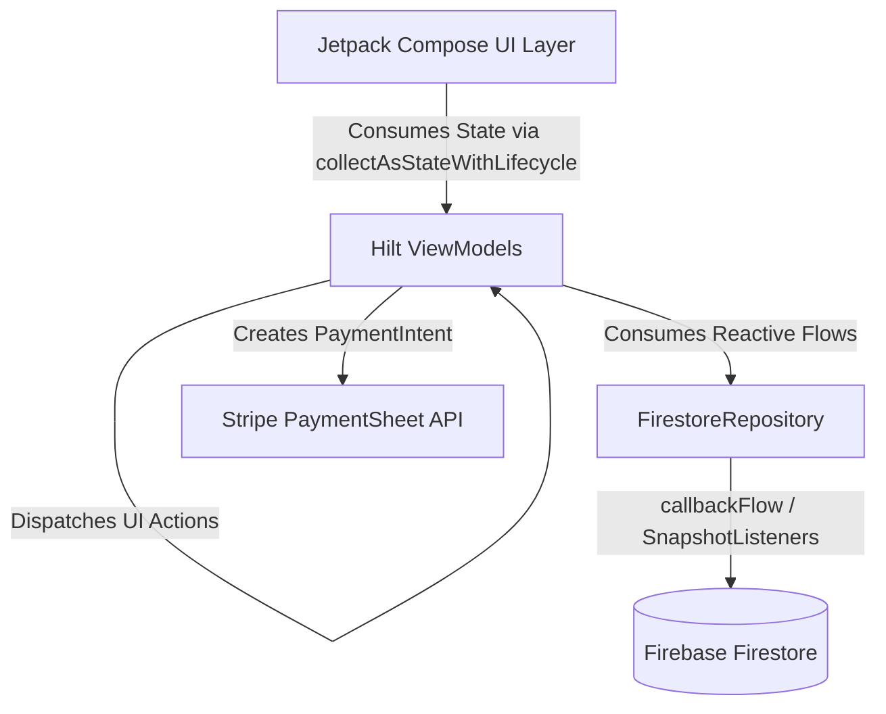

# ⚡ AURA TECH — High-Performance Android E-Commerce Showcase

[](https://kotlinlang.org)
[](https://developer.android.com/jetpack/compose)
[](https://firebase.google.com)
[](https://stripe.com)
[](https://dagger.dev/hilt/)

**AURA TECH** is a flagship native Android e-commerce application engineered with a high-contrast neo-dark aesthetic. Built using modern Android architecture, Jetpack Compose, Kotlin Coroutines, Firebase Firestore, Hilt, and Stripe PaymentSheet, it delivers a fluid end-to-end shopping experience for high-end audio gear and tech accessories.

---

## 🌟 Key Features

* 🚀 **Dynamic Home Dashboard:** Sector categories, live flash deal countdown timers, and promotional hero banners.
* 🎧 **Product Details Experience:** Gallery viewer, custom color selector, tech specifications, and customer review breakdowns.
* 🛒 **Cart & Promo Code Engine:** Dynamic subtotal calculation, discount savings, free express shipping indicator, and coupon validation.
* 💳 **Multi-Step Checkout & Stripe Payments:**
  * Step 1: Shipping Address Selection with inline address creation.
  * Step 2: Payment Gateway Selection (Credit/Debit, Google Pay, COD).
  * Step 3: Order Review with quick edit shortcuts and promo discount preservation.
  * Step 4: Native Stripe PaymentSheet processing & automated Firestore order confirmation.
* 👤 **User Hub & Order History:** Saved shipping addresses, active order tracking, and profile management.

---

## 🏗️ Architecture & Technical Stack

**AURA TECH** adheres to **Clean Architecture** and **Unidirectional Data Flow (UDF)** principles:



### Stack Components:
* **Language:** Kotlin
* **UI Framework:** Jetpack Compose + Material 3 Design System
* **Architecture:** MVVM / MVI with Unidirectional Data Flow
* **Dependency Injection:** Dagger Hilt
* **Asynchronous Streams:** Kotlin Coroutines & `StateFlow` / `callbackFlow`
* **Backend Database:** Firebase Firestore (Real-time snapshot listeners)
* **Payment Processing:** Stripe Android SDK (PaymentSheet API)
* **Testing:** JUnit & Kotlinx Coroutines Test

---

## 🧪 Testing & Code Quality

Unit tests verify model mappers and data transformations:

```bash
./gradlew test
```

* `FirestoreModelMapperTest` — Validates conversion of Firestore documents to Compose domain models and price calculations.

---

## 🛠️ Setup & Local Execution

1. **Clone Repository:**
   ```bash
   git clone https://github.com/dhruva/AuraTech.git
   cd AuraTech
   ```
2. **Firebase Setup:** Place your `google-services.json` inside the `app/` directory.
3. **Build Project:**
   ```bash
   ./gradlew app:assembleDebug
   ```
